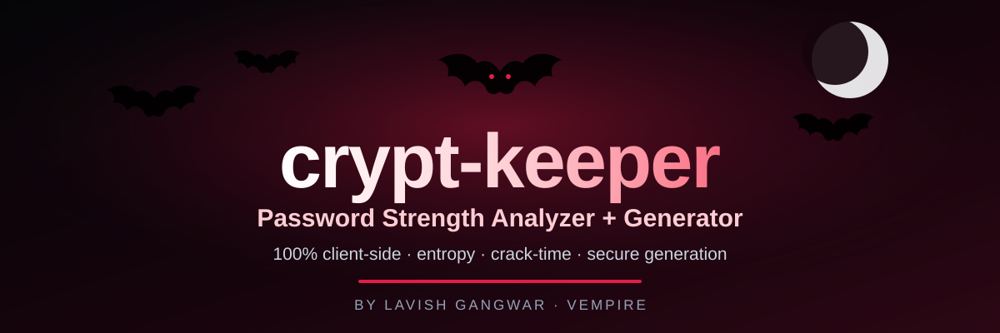

# crypt-keeper

A password strength analyzer and secure generator web app that runs 100% client-side — passwords never leave your browser and nothing is stored.

## Features

- **Analyzer** — masked password input with a show/hide toggle, a live strength meter, entropy estimate in bits, and an estimated crack time.
- **Pattern checks** — length, character classes, sequences (`abc`/`123`), repeated characters/patterns, keyboard walks (`qwerty` rows), a built-in common-password list, year/date patterns, and a leetspeak-normalized common-password check (so `p@ssw0rd` is caught too).
- **Findings with fixes** — every issue comes with a concrete suggestion for making the password stronger.
- **Generator** — length slider, toggles for lowercase / uppercase / digits / symbols, and an exclude-ambiguous (`Il1O0`) toggle. Randomness uses `crypto.getRandomValues` with rejection sampling.
- **Passphrase mode** — wordlist-based passphrases with word count, separator, capitalize, and add-a-number options.
- **Copy button** — one-click copy of the generated password or passphrase, plus an "Analyze this" shortcut.
- **Privacy** — no network calls, no accounts, no trackers, no storage. Everything happens locally in the page.

## Usage

Open `index.html` in any modern browser — no build step, no server required:

```bash
# Option 1: just open the file
open index.html        # macOS
xdg-open index.html    # Linux

# Option 2: serve it locally
npx serve .
```

Then:

1. Type a password in the **Analyzer** to see its strength, entropy, crack-time estimate, and fixes.
2. Use the **Generator** to create a random password or passphrase, copy it, and store it in your password manager.

## How it works

- **Entropy** is estimated from charset size × length (in bits), then reduced for predictable structure: sequences, keyboard walks, repeats, and year/date patterns each subtract bits, and common passwords (including leetspeak variants) are capped at a low entropy because attackers try them from small dictionaries first.
- **Crack time** assumes an *offline fast-hash attack at 10 billion guesses/second*, using the average case (half the keyspace). This is a deliberately harsh, attacker-friendly assumption — a well-hashed password (bcrypt/argon2) would take far longer.
- **Generation** draws from `crypto.getRandomValues` with rejection sampling to avoid modulo bias, guarantees at least one character from each selected class when length allows, and shuffles securely. Passphrases pick uniformly from an embedded wordlist.
- The pure logic (`estimateEntropy`, `analyzePassword`, `generatePassword`, `generatePassphrase`) is exported from `app.js` and unit-tested; the UI is guarded so the same file loads in Node for tests.

## Tests

Requires Node 20+:

```bash
node --check app.js
node --test
```

The suite covers weak/common password scoring, strong password scoring, sequence and keyboard-walk detection, generator length/charset/exclude-ambiguous behaviour, and passphrase word count and options.

## License

MIT — see [LICENSE](LICENSE). Copyright (c) 2026 Lavish Gangwar.
